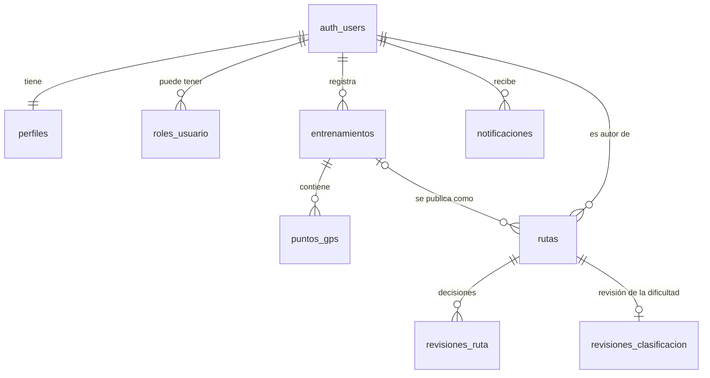

# TRAZA · Proyecto final de Desarrollo Móvil

Universidad de Medellín, 2026-2.

Este documento reúne lo que piden los lineamientos del proyecto final de Desarrollo Móvil. El `README.md` de la raíz es el del proyecto en Gestión de Proyectos Informáticos. El código de esta entrega está en la rama `Movil`.

## Integrantes

- Emmanuel Calad Correa
- Jorge Steven Lopez Arenas

## El caso

TRAZA registra entrenamientos con GPS (correr, trotar o caminar) y deja que el corredor publique su recorrido como una ruta para la comunidad. El proceso de negocio de la entrega es la publicación de esa ruta. Antes de aparecer en Explorar rutas, un administrador la revisa, un Runner Experto la aprueba asignándole una dificultad y el autor confirma la publicación. Cualquiera de los dos revisores puede rechazarla con un motivo.

Alrededor de ese proceso, la app tiene retos, niveles, insignias, recompensas, un foro moderado con IA y notificaciones.

## Roles

| Rol | En la base | Cómo se obtiene | Qué hace |
|---|---|---|---|
| Corredor | `perfiles.rol = 'usuario'` | Toda cuenta nueva lo recibe al registrarse. La app no deja escoger el rol. | Entrena, publica sus entrenamientos como rutas, confirma la publicación de las suyas, explora y busca rutas, hace retos y participa en el foro. |
| Administrador | `perfiles.rol = 'admin'` | Lo asigna el equipo desde el SQL Editor de Supabase. | Hace la primera revisión de las rutas, en la que aprueba o rechaza con un motivo. Gestiona retos, niveles y recompensas, y modera el foro. |
| Runner Experto | Una fila en `roles_usuario` con `rol = 'experto'` | Un trigger lo otorga a quien supera el décimo nivel, tiene 150 000 de XP y 6 meses de cuenta (`0012`). Para las pruebas lo asigna el equipo en el SQL Editor. | Es un corredor con un rol más. Hace la segunda revisión: aprueba asignando la dificultad o rechaza con un motivo. Con la ruta ya publicada, revisa una vez la clasificación que él mismo hizo (HU-35). |

La interfaz muestra solo las acciones de cada rol, y las pantallas restringidas van detrás de `SoloAdministrador` y `SoloExperto`. Además, la base aplica Row Level Security en cada tabla, y los cambios de estado pasan por funciones `security definer` que validan el rol, como `decidir_revision_ruta` y `clasificar_ruta`. Cómo asignar los roles de prueba está en [docs/datos_de_prueba.md](docs/datos_de_prueba.md).

## El camino de una ruta

```
publicar ──> en_revision ........ espera al administrador
   │              ├─ rechaza ───> rechazada (con motivo)
   │              └─ aprueba
   │                    v
   │          revision_experto ... espera al Runner Experto
   │              ├─ rechaza ───> rechazada (con motivo)
   │              └─ aprueba asignando la dificultad
   │                    v
   │            clasificada ...... espera la confirmación del autor
   │                    │ el autor confirma
   │                    v
   │             publicada ....... visible en Explorar rutas
   │
   └─ sin distancia ──> datos_incompletos (no entra a revisión)
```

| Estado | Quién actúa | Qué pasa |
|---|---|---|
| `en_revision` | Administrador | Aprueba y la ruta pasa a `revision_experto`, o la rechaza con un motivo. |
| `revision_experto` | Runner Experto | Aprueba asignando la dificultad y la ruta pasa a `clasificada`, o la rechaza con un motivo. |
| `clasificada` | Autor | Confirma con "Publicar ruta" y la ruta pasa a `publicada`. |
| `publicada` | El Runner Experto que la clasificó | Estado final: la ven todos los usuarios. Ese experto puede revisar su dificultad una sola vez. |
| `rechazada` | Autor | Estado final de esa ruta. Al autor le llega un aviso con el motivo, y puede volver a publicar el mismo entrenamiento como una ruta nueva. |
| `datos_incompletos` | Nadie | Estado final. El entrenamiento no registró distancia, así que no hay con qué clasificar la ruta. |

Cada paso lo da una función de la base: `decidir_revision_ruta`, `clasificar_ruta` y `confirmar_publicacion_ruta`. Ningún cliente actualiza `rutas` directamente. Las decisiones quedan en `revisiones_ruta`, y el autor recibe un aviso cuando su ruta se rechaza y cuando un Runner Experto la clasifica. Las migraciones que arman este flujo son `0029`, `0043`, `0045` y `0048`, y `0054` para la revisión de la clasificación.

## Reglas del negocio

1. Nadie revisa su propia ruta. Ni el administrador ni el Runner Experto pueden aprobar, rechazar ni clasificar una ruta de la que son autores (`decidir_revision_ruta`, `clasificar_ruta`).
2. Cada etapa es de un rol y van en orden. El administrador decide solo en `en_revision` y el Runner Experto solo en `revision_experto`. Una ruta que ya pasó de etapa no se vuelve a decidir.
3. Rechazar exige un motivo de 1 a 300 caracteres. Lo exigen la función y una restricción de la tabla (`rutas_rechazada_con_motivo`), y el autor lo lee en su aviso.
4. El Runner Experto aprueba asignando la dificultad: fácil, moderada o difícil. Una ruta `clasificada` siempre tiene dificultad (`rutas_clasificada_con_dificultad`).
5. Solo el autor publica su ruta, y solo cuando ya está `clasificada` (`confirmar_publicacion_ruta`).
6. Una ruta sin distancia no entra a revisión: nace en `datos_incompletos` (`preparar_ruta`).
7. Un entrenamiento se publica una sola vez, salvo que su ruta haya sido rechazada (índice único parcial de `0031`).
8. Una ruta tiene al menos dos puntos (`rutas_trazado_valido`).
9. La clasificación se revisa una sola vez, solo la revisa el Runner Experto que la hizo y solo con la ruta ya publicada (`puede_revisar_clasificacion`, `0054`).
10. Al publicar, el trazado pierde los puntos que quedan a menos de 200 m del inicio y del fin, para no revelar desde dónde sale el autor. Él puede elegir compartirlo entero.

## Tecnologías

Flutter para la app y Supabase (Postgres) como backend. Paquetes principales: Riverpod (estado), go_router (navegación), supabase_flutter, google_sign_in, http (Nominatim), geolocator y flutter_map (GPS y mapa), health (Health Connect) y path_provider (puntos del recorrido sin enviar).

## Cómo correr el proyecto

Requisitos: Flutter del canal stable (la entrega se probó con Flutter 3.44.8 y Dart 3.12.2), Android Studio y un dispositivo o emulador con Android 8.0 (API 26) o superior.

```bash
git clone https://github.com/aaronHenao/TRAZA
cd TRAZA
git switch Movil
flutter pub get
flutter run
```

La URL y la publishable key de Supabase están en `lib/supabase_config.dart`, así que la app se conecta sin configurar nada más. Esa key es pública por diseño: va en las apps cliente y lo que la protege es Row Level Security. La secret key no está en el repositorio y la app no la usa.

Otros comandos:

```bash
flutter run --release           # la versión release en el dispositivo conectado
flutter build apk --release     # el APK queda en build/app/outputs/flutter-apk/app-release.apk
flutter test                    # las pruebas automáticas
flutter run --dart-define=RUTA_INICIAL=/tracking   # abrir directo otra pantalla
```

### Login con Google

Google solo acepta el login desde un APK cuya firma esté registrada en el proyecto de Google Cloud de TRAZA. Como el APK se firma con la llave de depuración de cada PC (ver [Versión, firma y APK](#versión-firma-y-apk)), quien compile en un PC nuevo tiene que registrar la SHA-1 de su llave:

1. Sacar la SHA-1 de la llave de depuración:

   ```bash
   keytool -list -v -keystore ~/.android/debug.keystore -alias androiddebugkey -storepass android -keypass android
   ```

   En Windows, la llave está en `%USERPROFILE%\.android\debug.keystore`. También sale con `./gradlew signingReport` dentro de `android/`.

2. Registrarla en el proyecto de Google Cloud de TRAZA como un cliente OAuth de Android con el paquete `com.traza.traza`. Cada SHA-1 va en su propio cliente.

El client ID web de `lib/google_config.dart` es el que Supabase tiene configurado en Authentication → Providers → Google para verificar el inicio de sesión.

## Configuración del backend: Supabase en lugar de Firebase

Los lineamientos piden Firebase Authentication y Firestore. TRAZA usa Supabase desde el primer sprint porque el proceso necesita una base relacional: las reglas del negocio dependen de llaves foráneas, restricciones e integridad entre tablas, y Firestore, al ser NoSQL, no las ofrece. El equipo se lo consultó al docente y la respuesta está pendiente.

| Lo que piden los lineamientos | En TRAZA |
|---|---|
| Firebase Authentication con correo y contraseña | Supabase Auth: registro, inicio y cierre de sesión, recuperación de contraseña y sesión restaurada al abrir la app. También admite el inicio de sesión con Google. |
| Firestore | Postgres de Supabase |
| Reglas de seguridad de Firestore | Row Level Security y funciones `security definer`, versionadas en `supabase/migrations/` |
| Ver los cambios de otros roles | Supabase Realtime en el foro y las notificaciones (`0028`, `0034`). Las demás pantallas muestran el estado nuevo al recargar. |
| Firebase Crashlytics | Firebase Crashlytics, el único servicio de Firebase que usa la app (ver [Reporte de errores](#reporte-de-errores-crashlytics)) |

Dónde está cada pieza de la configuración:

- **Proyecto de Supabase:** URL y publishable key en `lib/supabase_config.dart`.
- **Google:** client ID web en `lib/google_config.dart`.
- **Correos de Supabase Auth:** las plantillas para confirmar el registro y para recuperar la contraseña están en `supabase/templates/`.
- **Moderación del foro:** la Edge Function `supabase/functions/moderar-foro/`. Sus secretos (`NVIDIA_API_KEY` y `MODERACION_WEBHOOK_SECRET`) están guardados en Supabase, no en el repositorio. Cómo desplegarla está en [docs/deudas.md](docs/deudas.md).
- **Esquema y reglas de acceso:** las migraciones de `supabase/migrations/` (ver [Base de datos](#base-de-datos)).
- **Proyecto de Firebase (`traza-final-movil`):** `android/app/google-services.json` y `lib/firebase_options.dart`, generados con `flutterfire configure --project=traza-final-movil --platforms=android`. Como la publishable key, la llave que traen identifica al proyecto y no es un secreto.

### Reporte de errores (Crashlytics)

`lib/services/reporte_errores.dart` envía a Crashlytics los errores que la app no atrapó: los de Flutter, los asíncronos de Dart y los crashes nativos de Android. Solo funciona en el APK release de Android. En debug no se envía nada.

Para no exponer datos personales:

- De cada error viaja solo el tipo (`StateError`, `PostgrestException`) y la pila. El mensaje no, porque el de Supabase puede traer el valor que falló y el del GPS, coordenadas. Tampoco la descripción de los widgets, que puede incluir el texto de la pantalla.
- No se identifica al usuario: ni su id, ni su correo, ni claves o logs propios. `test/config/configuracion_crashlytics_test.dart` falla si alguien lo agrega en `lib/`.
- El proyecto de Firebase no tiene Google Analytics.

Evento de prueba: compilar con `flutter build apk --release --dart-define=CRASHLYTICS_PRUEBA=true`, abrir la app, cerrarla y volver a abrirla. A los pocos minutos aparece en Firebase → Crashlytics un `StateError` cuyo mensaje original traía un correo inventado. El reporte llega sin ese correo. Ese APK es solo para la prueba; el de entrega se compila sin el `--dart-define`.

## Base de datos

El equipo comparte un solo proyecto de Supabase. Las migraciones de `supabase/migrations/` (de la `0001` a la `0056`) se aplican en orden, una sola vez, desde el SQL Editor de ese proyecto. Por eso no se corren al clonar el repositorio, y tampoco se usa `supabase db push`, que intentaría aplicarlas todas otra vez sobre la base compartida. Varias traen al final un guion de verificación para el SQL Editor que recorre sus reglas y deshace los datos de prueba.

## Endpoint HTTP

Para la búsqueda de Explorar rutas, TRAZA consulta **Nominatim**, el buscador de lugares de OpenStreetMap. Convierte lo que el usuario escribe ("Envigado", "El Poblado") en una zona, y a los resultados se suman las rutas que arrancan ahí.

```
GET https://nominatim.openstreetmap.org/search
      ?q=<texto>&format=jsonv2&limit=5&countrycodes=co&accept-language=es&addressdetails=1
      [&viewbox=<caja de ±0,2° alrededor del usuario>&bounded=1]
User-Agent: TRAZA/1.0 (+https://github.com/aaronHenao/TRAZA)
```

La respuesta es una lista JSON de lugares. De cada uno se usan `category`, `type`, `place_rank`, `name`, `display_name`, `address.state` y `boundingbox`. Solo cuenta como zona un área (municipio, comuna, barrio, parque o accidente natural) que se llame como lo escrito, y se convierte en el modelo `Zona`: nombre, región y sus cuatro bordes.

| Capa | Dónde está |
|---|---|
| Petición HTTP y mapeo del JSON | `NominatimBuscadorDeZonas`, detrás de la interfaz `BuscadorDeZonas` (`lib/services/zonas_service.dart`) |
| Modelo | `Zona` (`lib/models/zona.dart`) |
| Coordinación con la base | `busquedaRutasProvider` (`lib/services/busqueda_rutas_provider.dart`) le pasa la zona al repositorio de rutas, que busca en Supabase con `buscar_rutas` |
| Interfaz | `RutasScreen` (`lib/screens/rutas/rutas_screen.dart`) |

Cómo se comporta:

- **Estados.** Mientras busca, muestra un indicador de carga junto al rótulo. Si encuentra la zona, la nombra encima de los resultados. Si lo escrito no es un lugar, quedan las rutas que coinciden por nombre o creador. Sin resultados, dice "No encontramos rutas" y sugiere revisar lo escrito o buscarlo como lugar.
- **Errores.** Sin conexión, sin respuesta en 8 segundos, con un código distinto de 200 o con un JSON ilegible, el servicio lanza `ZonaNoDisponibleException`. La pantalla dice "No pudimos buscar «…» como lugar: estas coinciden por nombre o creador" y ofrece "Reintentar", sin mostrar el error técnico.
- **Sin peticiones repetidas.** Solo pregunta cuando el usuario confirma la búsqueda, nunca con cada letra. Lo encontrado se guarda, y dos búsquedas iguales al mismo tiempo salen como una sola. Si el usuario sale de la pantalla antes de que llegue la respuesta, esa búsqueda se abandona.
- **Política de uso de Nominatim.** A lo sumo una consulta por segundo, la app se identifica con su User-Agent y la pantalla muestra "Lugares: © colaboradores de OpenStreetMap".

## Modelo de datos

Todo cuelga del usuario de Supabase Auth (`auth.users`): `perfiles.id` es el mismo uid, y cada tabla con datos de un usuario lo referencia. El núcleo del proceso:



| Tabla | Qué guarda | Campos principales |
|---|---|---|
| `perfiles` | El perfil de cada usuario | `nombre`, `rol` (`usuario` o `admin`), `peso_kg`, `altura_cm`, `fecha_nacimiento`, `genero` |
| `roles_usuario` | Roles adicionales; hoy solo `experto` | `usuario_id`, `rol` |
| `permisos_usuario` | Si el usuario concedió ubicación y salud | `tipo_permiso`, `concedido` |
| `objetivos` | Las metas del onboarding | `tipo` (`distancia` o `frecuencia`), `valor_meta` |
| `tipos_actividad` | El catálogo: Correr, Trote y Caminar | `nombre` |
| `entrenamientos` | Cada actividad | `usuario_id`, `tipo_actividad_id`, `fecha_inicio`, `fecha_fin`, `duracion_segundos`, `distancia_total_m`, `estado` (`en_curso`, `finalizado` o `cancelado`) |
| `puntos_gps` | El recorrido de cada entrenamiento, sin altitud | `entrenamiento_id`, `latitud`, `longitud`, `capturado_en`, `orden_secuencia`, `tramo` |
| `rutas` | El recorrido publicado y su estado | `autor_id`, `autor_nombre`, `entrenamiento_id`, `nombre`, `descripcion`, `trazado` (jsonb), `inicio_latitud`, `inicio_longitud`, `distancia_km`, `estado`, `dificultad`, `clasificada_por`, `motivo_rechazo`, `recorrido_completo`, `fecha_publicacion` |
| `revisiones_ruta` | Las decisiones del administrador y del experto | `ruta_id`, `revisor_id`, `revisor_nombre`, `etapa`, `decision`, `motivo`, `fecha` |
| `revisiones_clasificacion` | La revisión de la dificultad (HU-35), una por ruta | `ruta_id`, `revisor_id`, `dificultad_anterior`, `dificultad`, `fecha` |
| `notificaciones` | Los avisos de cada usuario | `usuario_id`, `tipo`, `titulo`, `mensaje`, `entidad_id`, `leida_en` |

Las demás tablas son de la gamificación (`retos`, `retos_usuario`, `experiencia_ganada`, `niveles`, `insignias`, `insignias_usuario`, `recompensas`, `canjes_recompensa`) y del foro (`publicaciones_foro`, `comentarios_foro`, `versiones_publicacion_foro`, `versiones_comentario_foro`, `moderaciones_foro`, `reportes_foro`, `bitacora_moderacion_foro`). Cada una está en su migración, con sus restricciones y policies.

## Operación local-first y sincronización

**Lo que funciona hoy (SCRUM-292 y Drift).** Un entrenamiento en curso no pierde su recorrido aunque se caiga la red:

- Cada punto GPS se escribe en el teléfono apenas se captura, en una base SQLite local con Drift (`lib/services/base_local.dart`, `AlmacenRecorridoDrift`). El orden y el tramo de cada punto se fijan al capturarlo.
- Cada recorrido guardado lleva su identidad estable (el id del entrenamiento en Supabase), el uid de la cuenta dueña, la fecha de su última actualización y su estado de sincronización: si queda algo por subir (`pendiente_sync`), el motivo del último fallo (`ultimo_error`, un texto fijo) y si la base lo rechazó.
- Los puntos suben a Supabase por lotes, y solo se borran del teléfono cuando la base los aceptó.
- Reintentar no duplica: `puntos_gps` tiene un índice único por entrenamiento y número de orden (`0053`), y el envío usa `on conflict do nothing`.
- Lo que no alcanzó a subir se reenvía al abrir la app con sesión (`ReenvioRecorridos`), y solo lo de esa cuenta: lo de otra cuenta del mismo teléfono se queda hasta que vuelva. Si la base lo rechaza porque el entrenamiento ya no existe o no es de esa cuenta, se anota el motivo, deja de reintentarse y queda para que la persona lo descarte.
- Lo que hubiera quedado en los archivos JSONL de versiones anteriores se pasa a la base local la primera vez que se abre la app.
- Descartar un entrenamiento también borra sus puntos del teléfono.
- Los filtros de Explorar rutas (dificultad y distancia) se recuerdan con SharedPreferences (`lib/services/preferencias_explorar.dart`).

Iniciar y finalizar un entrenamiento sí necesitan conexión. Al iniciar se crea su fila en `entrenamientos`, y si finalizar falla, la app lo avisa y el botón "Finalizar" se puede volver a tocar.

**Pendiente:**

- Mostrar en pantalla el estado de sincronización, aparte del estado del negocio. Los datos ya están: `recorridosLocalesProvider` emite los recorridos de la cuenta con su estado.

## Privacidad: datos, finalidad y acceso

| Dato | Para qué se usa | Quién lo ve |
|---|---|---|
| Correo y contraseña | Iniciar sesión. Los maneja Supabase Auth; la contraseña no pasa por las tablas de la app. | Ningún otro usuario. |
| Nombre | Identificar al autor de las rutas y de lo que se escribe en el foro. | El usuario en su perfil. Los demás lo ven en lo que él publica. |
| Peso, altura, fecha de nacimiento y género (opcionales) | Completar el perfil. | Solo el usuario. |
| Ubicación GPS | Durante un entrenamiento, dibujar el recorrido y calcular la distancia y el ritmo, con la notificación del servicio a la vista. En Explorar rutas, ordenar las rutas por cercanía: esa posición se manda a la consulta y no se guarda. La app no pide ubicación en segundo plano. | Solo el usuario, mientras no publique el recorrido como ruta. |
| Rutas publicadas | Compartir el recorrido: nombre, trazado sin los 200 m de cada extremo (salvo que el autor elija lo contrario), distancia y dificultad. | Todos los usuarios, una vez publicada. Mientras se revisa, el autor y el revisor de cada etapa. |
| Frecuencia cardiaca, calorías y pasos (Health Connect, opcional) | Mostrarlos en el resumen del entrenamiento. Se leen del teléfono y no se guardan en la base: solo se guarda si el usuario dio el permiso. | Solo el usuario. |
| Publicaciones y comentarios del foro | Conversar con la comunidad. Antes de publicarse, el texto de los corredores se envía a NVIDIA (Nemotron Content Safety) para moderarlo. | La comunidad cuando se aprueba. El administrador ve también lo retenido y lo rechazado. |
| Notificaciones | Avisar las decisiones sobre sus rutas y sus publicaciones. | Solo el usuario. |

El acceso por rol lo hace cumplir la base con Row Level Security: cada usuario lee y escribe sus propios registros, el administrador ve lo que revisa y modera, y el Runner Experto ve las rutas que esperan su revisión.

Servicios externos que reciben datos:

- **Supabase:** la base, la autenticación, Realtime y la Edge Function.
- **Google:** el inicio de sesión, solo para quien lo elige.
- **Nominatim (OpenStreetMap):** el texto buscado y, si se conoce, una caja alrededor del usuario con su posición redondeada a la décima de grado (unos 11 km). Nunca la posición exacta.
- **Esri:** las imágenes del mapa, así que sabe qué zona del mapa se está mirando.
- **NVIDIA:** el texto del foro que se modera.
- **Firebase Crashlytics:** los errores no atrapados del APK release, con el tipo de error y la pila, el modelo del teléfono, las versiones de Android y de la app, y un identificador de instalación aleatorio que no está ligado a la cuenta. No recibe el mensaje del error ni nada que identifique al usuario.

La app no guarda contraseñas ni tokens por su cuenta. La sesión la guarda el SDK de Supabase en el teléfono para restaurarla al abrir la app (ver [Límites conocidos](#límites-conocidos)).

## Versión, firma y APK

- **Versión:** `1.0.0+1` en `pubspec.yaml`, que en Android es versionName `1.0.0` y versionCode `1`. Se sube con cada APK nuevo de entrega.
- **Compilación:** `flutter build apk --release`, que deja el APK en `build/app/outputs/flutter-apk/app-release.apk`. El que se entrega se renombra con el código del proyecto y la versión.
- **Firma:** el APK release va firmado con la llave de depuración de Android del PC que lo compila (`signingConfig = signingConfigs.getByName("debug")` en `android/app/build.gradle.kts`). Es la firma de desarrollo que aceptan los lineamientos; no hay keystore de producción. Compilar en release y firmar con una llave de producción son cosas distintas: este APK es release, pero su firma es de desarrollo. Por esa firma, el login con Google solo funciona si la SHA-1 de esa llave está registrada, y un APK compilado en otro PC no se instala encima de este sin desinstalar primero.
- **Versión probada:** `1.0.0+1`, en APK release, el 2026-11-06, en una Samsung Galaxy Tab S10 FE (SM-X520, Android 16). Se recorrió el flujo con los tres roles: login con correo y con Google, sesión restaurada al volver a abrir, permisos, búsqueda de zonas, publicación de una ruta, revisión del administrador, clasificación del Runner Experto y cambio de cuenta.

## Datos de prueba

Las cuentas por rol, una ruta en cada uno de los seis estados y cómo reproducirlas están en [docs/datos_de_prueba.md](docs/datos_de_prueba.md). Las credenciales no están en el repositorio: se comparten por el medio privado que indique el docente.

## Límites conocidos

- La base es Supabase y no Firebase. Falta la respuesta del docente.
- Crashlytics solo está configurado en Android. Como no recibe el mensaje del error, a veces hay que reproducirlo para diagnosticarlo.
- Todavía no hay un indicador del estado de sincronización en pantalla. Sin red, lo que se conserva son los puntos del recorrido en curso; iniciar y finalizar necesitan conexión.
- La policy de update de `perfiles` no protege la columna `rol` (ver RNF-14 en [docs/deudas.md](docs/deudas.md)). Falta una migración que impida cambiarla desde el cliente.
- La sesión de Supabase, con sus tokens de acceso y de refresco, la guarda `supabase_flutter` en SharedPreferences, que es su almacenamiento por defecto.
- Las rutas publicadas antes de que existiera la clasificación no tienen dificultad, y las publicadas antes de RNF-04 conservan sus extremos exactos.
- No hay desnivel: los puntos GPS no guardan altitud.
- Una ruta en `datos_incompletos` no se puede completar después.
- Las bandejas de revisión no son en tiempo real: se actualizan al entrar, al deslizar y al decidir.
- Por la política de Nominatim, la búsqueda de zonas no autocompleta y hace como mucho una consulta por segundo.
- Solo se probó en Android. En iOS falta activar HealthKit en Xcode.

El detalle de cada pendiente está en [docs/deudas.md](docs/deudas.md), y los defectos encontrados y corregidos, en [docs/bugs.md](docs/bugs.md).

## Estructura de carpetas

```
lib/
├── main.dart                      # arranque y navegación (go_router)
├── supabase_config.dart           # URL + publishable key
├── google_config.dart             # client ID web de Google
├── models/                        # Perfil, Entrenamiento, PuntoGps, Ruta, Zona, etc.
├── services/                      # repositorios y providers: Supabase, Nominatim, GPS, almacén local
├── screens/
│   ├── admin/                     # panel del administrador: retos, niveles, recompensas, foro
│   ├── auth/                      # login, registro, recuperar contraseña
│   ├── foro/                      # foro de la comunidad
│   ├── home/                      # portada, actividad, progresión, Runner Experto
│   ├── notificaciones/            # avisos del usuario
│   ├── onboarding/                # perfil, objetivos y permisos
│   ├── recompensas/               # catálogo del corredor
│   ├── retos/                     # retos y su historial
│   ├── rutas/                     # explorar, detalle, publicar, revisión y clasificación
│   ├── summary/                   # resumen del entrenamiento
│   └── tracking/                  # cronómetro + mapa + distancia en vivo
├── theme/                         # colores, tipografía, tema y logos
├── utils/                         # fechas relativas, texto para buscar y validaciones
└── widgets/                       # componentes reutilizables

supabase/
├── migrations/                    # historial versionado del esquema, en orden (0001 a 0056)
├── functions/moderar-foro/        # Edge Function de moderación del foro con IA
└── templates/                     # correos de confirmación y de recuperar contraseña

docs/                              # bugs, deudas, datos de prueba y prototipo
test/                              # pruebas de modelos, servicios, pantallas e integración
```
